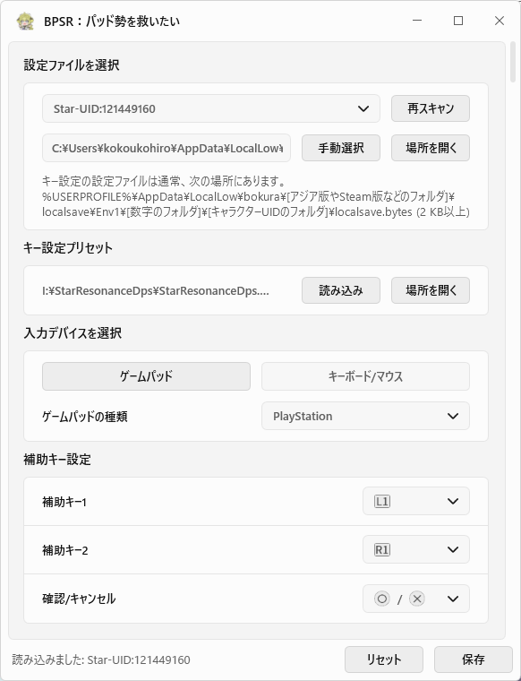

## BPSR：パッド勢を救いたい

Blue Protocol: Star Resonanceのパッド用ボタン配置を編集するための非公式ツールです。
ゲーム内の設定だけでは調整しにくいボタン割り当てを、`localsave.bytes`を直接編集することで変更できます。

2.0.0から[StarResonanceDps](https://github.com/kokoukohiro/StarResonanceDps)のプラグインになりました。単体では動きません。
単体で動く旧版は[v1.13](https://github.com/kokoukohiro/BPSRControllerHelper/releases/tag/v1.13)です(ソースは`v1.13`フォルダ)。

### 主な機能

- ゲームパッドとキーボード/マウスのボタン配置の編集

### 導入

1. [リリース](https://github.com/kokoukohiro/BPSRControllerHelper/releases/latest)から`KeybindTool.dll`をダウンロードします。
2. StarResonanceDpsの「プラグイン」タブの「プラグインを追加」で`KeybindTool.dll`を選びます。

### 更新

StarResonanceDpsを閉じて、`Plugins\KeybindTool\KeybindTool.dll`を新しいファイルで上書きします。

### 注意事項

- ゲーム起動中にこのツールで`localsave.bytes`を編集しても、変更は反映されません。
- ボタン配置を編集する際は、**必ずゲームを終了した状態で** 行ってください。

### スクリーンショット

### 対応環境

- Windows

### ライセンス

GPL-3.0です。Blue Protocol: Star Resonanceの名前・データ・画像はこのライセンスの対象外で、権利はそれぞれの権利者に属します。
